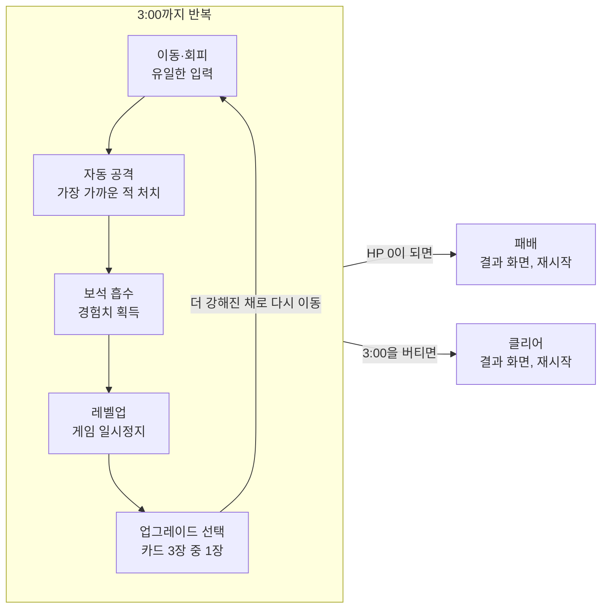

# 탑다운 뱀서라이크 미니 게임 PRD

2026-10-29

## 개요

이동만으로 몰려오는 적 떼를 피하며 3분을 버티는 탑다운 뱀서라이크 미니 게임이다. 공격은 자동으로 나가고, 플레이어의 선택은 '어디로 움직일까'와 '레벨업 때 무엇을 고를까' 두 가지뿐이다.

- **한 줄 요약:** 한 손가락으로 즐기는 3분짜리 생존 러시.
- **핵심 판타지:** 처음엔 쫓기던 내가 3분 뒤엔 화면을 쓸어버리는 성장감.
- **세션 길이:** 1판 3분 + 결과 화면, 재시작까지 5초 이내.
- **가칭:** Survive 3 (확정 전)

## 목표와 비목표

승리 조건은 단 하나, 체력 0이 되기 전에 3:00을 버티는 것이다. 처음 하는 사람도 2~3판 안에 첫 클리어를 경험하도록 설계한다.

### 목표

- 이동 외 입력 없이 1판이 완결되는 게임 루프
- 3분 안에 '약함 → 강함' 성장 곡선이 체감될 것
- 즉시 재시작으로 '한 판 더'를 유도

### 성공 지표 (출시 후 2주 기준, 목표치는 가설)

| 지표 | 목표 |
| --- | --- |
| 첫 판 3분 생존율 | 25~40% |
| 3판 이내 첫 클리어 비율 | 60% 이상 |
| 1세션당 평균 판 수 | 3판 이상 |
| 결과 화면 → 재시작 클릭률 | 50% 이상 |

### 비목표 (이번 범위에서 만들지 않음)

- 멀티플레이 (협동·대전·랭킹 서버 포함)
- 스토리 (컷신, 대사, 캐릭터 설정)
- 점프 (높이 축, 지형 넘기, 회피 액션)
- 수동 공격, 조준, 스킬 버튼

## 대상 플레이어와 플랫폼

짧은 틈에 가볍게 한 판 하는 캐주얼 플레이어가 1차 대상이며, 웹 브라우저(PC 우선, 모바일 대응)로 설치 없이 실행한다.

| 항목 | 내용 |
| --- | --- |
| 1차 대상 | 뱀서라이크를 알거나 처음 접하는 캐주얼 게이머, 1판 5분 이하 선호 |
| 플랫폼 | 웹 브라우저 (PC 크롬·엣지·사파리, 모바일 크롬·사파리) |
| 입력 | PC: WASD / 방향키, 모바일: 가상 조이스틱(터치한 위치 기준) |
| 화면 | 가로 16:9 기본, 모바일 세로 화면도 플레이 가능 |
| 언어 | 한국어·영어 (UI 텍스트 최소화) |

## 핵심 게임 루프

플레이어가 직접 하는 일은 이동뿐이고, 공격·흡수는 자동이다. 루프가 한 바퀴 돌 때마다 업그레이드가 하나씩 쌓여, 3분 뒤에는 화면을 쓸어버릴 만큼 강해진다.

## 기능 요구사항

P0만으로 '3분 생존' 한 판이 처음부터 끝까지 돌아가야 한다. P1은 재미와 재방문을, P2는 여유가 있을 때의 확장을 담당한다.

- **P0** — 없으면 출시 불가. 플레이 가능한 최소 버전(MVP)
- **P1** — 출시 품질. 첫 공개 전에 넣는 것을 목표
- **P2** — 출시 후 업데이트 후보

### P0 · 필수

| ID | 기능 | 요구사항 | 완료 기준 |
| --- | --- | --- | --- |
| P0-01 | 이동 | 8방향(아날로그) 이동, 가속 없이 즉시 반응 | 입력 후 1프레임 안에 이동 시작 |
| P0-02 | 카메라 | 플레이어 중심 추적, 맵은 무한 스크롤(타일 반복) | 경계에 막히는 일 없음 |
| P0-03 | 자동 공격 | 기본 무기 1종이 쿨다운마다 가장 가까운 적을 자동 공격 | 공격 버튼 없이 적 처치 가능 |
| P0-04 | 적 스폰 | 화면 밖 링 영역에서 생성되어 플레이어를 추적 | 화면 안에서 갑자기 생성되지 않음 |
| P0-05 | 적 종류 | 최소 2종: 기본형, 빠른형 | 두 종의 속도·체력이 구분됨 |
| P0-06 | 충돌·피해 | 적 접촉 시 피해, 피격 후 0.5초 무적 | 연속 접촉으로 즉사하지 않음 |
| P0-07 | 체력 | HP 바 표시, 0이 되면 게임 오버 | 게임 오버 화면으로 전환 |
| P0-08 | 경험치·레벨업 | 처치 시 경험치 보석 드롭, 근처에서 자동 흡수 | 경험치 바가 차면 레벨업 |
| P0-09 | 업그레이드 선택 | 레벨업 시 일시정지, 3개 중 1개 선택 | 선택지는 이동 키/터치로 고를 수 있음 |
| P0-10 | 업그레이드 풀 | 무기 2종 이상 + 패시브 4종 이상, 무기 최대 레벨 5 | 3분 동안 선택지가 바닥나지 않음 |
| P0-11 | 타이머·승리 | 3:00 카운트, 도달 시 클리어 | 3:00에 승리 화면 표시 |
| P0-12 | 난이도 곡선 | 시간에 따라 스폰 수·적 종류 증가 | 아래 밸런스 표대로 동작 |
| P0-13 | 기본 화면 | 시작 → 플레이 → 결과(승리/패배) → 재시작 | 결과에서 재시작까지 5초 이내 |
| P0-14 | 일시정지 | ESC / 화면 버튼으로 정지·재개 | 탭 전환 시 자동 일시정지 |

### P1 · 출시 품질

| ID | 기능 | 요구사항 |
| --- | --- | --- |
| P1-01 | 보스 | 2:30에 보스 1체 등장, 처치하지 않아도 3:00 생존이면 클리어 |
| P1-02 | 엘리트 적 | 1:00부터 체력 높은 엘리트, 처치 시 보물 상자(업그레이드 1개) |
| P1-03 | 무기 확장 | 무기 4종 이상 (투사체, 근접 회전, 범위 장판, 관통) |
| P1-04 | 타격감 | 피격 플래시, 데미지 숫자, 처치 파티클, 약한 화면 흔들림 |
| P1-05 | 사운드 | 효과음(공격·피격·레벨업·처치), BGM 1곡, 음소거 버튼 |
| P1-06 | 드롭 아이템 | 회복 고기, 자석(화면 내 보석 전부 흡수) |
| P1-07 | 결과 통계 | 생존 시간, 처치 수, 도달 레벨, 사용 무기 |
| P1-08 | 최고 기록 | 기기 로컬 저장 (최장 생존, 최다 처치) |
| P1-09 | 튜토리얼 | 첫 판 시작 시 '움직이기만 하세요' 안내 1장 |
| P1-10 | 설정 | 음량, 화면 흔들림 끄기, 데미지 숫자 끄기 |

### P2 · 확장 후보

| ID | 기능 | 요구사항 |
| --- | --- | --- |
| P2-01 | 무기 진화 | 특정 무기 최대 레벨 + 특정 패시브 보유 시 상자에서 진화 |
| P2-02 | 캐릭터 선택 | 시작 무기·기본 능력치가 다른 캐릭터 2~3종 |
| P2-03 | 메타 성장 | 판마다 코인 획득, 영구 능력치 업그레이드 |
| P2-04 | 맵 변형 | 맵 테마 2종, 장애물 배치 |
| P2-05 | 도전 모드 | 하드 난이도, 5분 모드 |
| P2-06 | 업적 | 조건 달성 시 배지 (예: 무피격 1분) |
| P2-07 | 공유 | 결과 화면 이미지 저장·공유 |

## 밸런스 초기값

3분을 30~45초 단위 4구간으로 나눠, 구간마다 압박을 한 단계씩 올린다. 아래 수치는 첫 플레이테스트용 출발점이며 테스트 후 조정한다.

### 구간별 웨이브

| 구간 | 시간 | 등장 적 | 동시 최대 적 수 | 의도 |
| --- | --- | --- | --- | --- |
| 1. 적응 | 0:00~0:45 | 기본형 | 30 | 조작 익히기, 레벨 3~4 도달 |
| 2. 성장 | 0:45~1:30 | 기본형 + 빠른형 | 60 | 무기 2개째 확보 |
| 3. 압박 | 1:30~2:30 | + 엘리트(P1), 포위 웨이브 1회 | 100 | 위기와 빌드 완성 |
| 4. 결전 | 2:30~3:00 | + 보스(P1), 스폰 최대 | 150 | 마지막 30초 버티기 |

### 기본 수치

| 대상 | 항목 | 초기값 |
| --- | --- | --- |
| 플레이어 | HP / 이동속도 | 100 / 160 px/s |
| 플레이어 | 피격 무적 / 보석 흡수 반경 | 0.5초 / 64 px |
| 기본 무기 | 피해 / 쿨다운 / 사거리 | 10 / 1.0초 / 300 px |
| 기본형 적 | HP / 속도 / 접촉 피해 | 10 / 80 px/s / 5 |
| 빠른형 적 | HP / 속도 / 접촉 피해 | 6 / 140 px/s / 4 |
| 엘리트 (P1) | HP / 속도 / 접촉 피해 | 150 / 70 px/s / 15 |
| 보스 (P1) | HP / 속도 / 접촉 피해 | 1,500 / 60 px/s / 25 |
| 레벨업 | 필요 경험치 | 5 + 레벨 × 5 (3분에 약 레벨 15 목표) |

## UX/UI 화면 구성

화면은 시작·플레이·레벨업·결과 4개뿐이며, 플레이 중 HUD는 타이머·HP·경험치 세 가지만 보여 준다.

| 화면 | 구성 요소 | 비고 |
| --- | --- | --- |
| 시작 | 타이틀, 시작 버튼, 최고 기록(P1), 설정(P1) | 아무 키 / 탭으로 시작 |
| 플레이 HUD | 상단 중앙 타이머(남은 시간), 상단 경험치 바 + 레벨, 플레이어 머리 위 HP 바 | 보유 무기 아이콘은 좌상단 작게 |
| 레벨업 | 카드 3장 (아이콘, 이름, 레벨, 한 줄 효과) | 게임 일시정지, 실수 방지로 0.3초 입력 지연 |
| 일시정지 | 재개, 재시작, 설정 | 탭 전환 시 자동 표시 |
| 결과 | 승리/패배 제목, 생존 시간, 처치 수, 레벨, 재시작 버튼 | 재시작이 가장 큰 버튼 |

- 마지막 10초는 타이머를 빨갛게 키워 긴장감을 준다.
- 모바일은 조이스틱이 손가락을 가리지 않도록 터치한 자리에 생성한다.

## 기술 요구사항과 성능

적 150체와 투사체가 동시에 있어도 60fps를 유지하는 것이 최우선 기술 목표다.

| 항목 | 요구사항 |
| --- | --- |
| 엔진 후보 | Phaser 3 또는 PixiJS (HTML5 Canvas/WebGL), 확정 필요 |
| 프레임 | PC 60fps, 중급 모바일 기기 최소 45fps |
| 동시 개체 | 적 150 + 투사체 100 + 보석 200 |
| 최적화 | 오브젝트 풀링, 공간 분할(그리드)로 충돌 검사, 화면 밖 보석은 일정 수 이상이면 합치기 |
| 로딩 | 첫 로딩 3초 이내, 전체 용량 10MB 이하 |
| 저장 | 최고 기록·설정은 localStorage (서버 없음) |
| 아트 | 2D 픽셀 또는 단색 도형 스프라이트, 적은 실루엣만으로 종류 구분 |
| 분석 | 판 시작·종료(생존 시간, 사인) 이벤트 로깅으로 성공 지표 측정 |

## 마일스톤, 리스크, 미결 사항

P0 플레이어블 → 밸런스 테스트 → P1 → 출시 순서로 진행하고, 각 단계는 앞 단계의 완료 기준을 넘어야 시작한다. 기간은 인원·일정이 정해지면 채운다.

### 마일스톤

1. **M1 프로토타입:** 이동, 자동 공격, 적 1종, 타이머로 '피하며 쏘는 재미' 확인
2. **M2 P0 완성:** P0-01~P0-14 전부 동작, 처음부터 끝까지 한 판 가능
3. **M3 밸런스 테스트:** 외부 테스터 5명 이상, 첫 판 생존율 25~40%에 맞춤
4. **M4 P1 완성:** 보스·타격감·사운드·통계 반영
5. **M5 출시:** 웹 배포, 지표 수집 시작

### 리스크

| 리스크 | 영향 | 대응 |
| --- | --- | --- |
| 이동만으로는 단조롭게 느껴짐 | 재시작률 저하 | 레벨업 선택지의 체감 차이를 크게, 포위 웨이브로 위치 판단 강제 |
| 모바일 성능 부족 | 프레임 저하, 조작감 악화 | 동시 개체 상한을 기기별로 낮춤, 파티클 축소 |
| 3분이 너무 쉽거나 어려움 | 성공 지표 미달 | 웨이브 수치를 데이터 파일로 분리해 빠르게 조정 |
| 화면이 적으로 가득 차 가독성 저하 | 사망 원인 불명확 | 적 실루엣·색 구분, 피격 시 원인 적 하이라이트 |

### 미결 사항

- [ ] 엔진 확정: Phaser 3 vs PixiJS
- [ ] 아트 스타일: 픽셀 아트 vs 단색 도형
- [ ] 보스를 P0로 올릴지 (클리어의 정점 연출 필요 여부)
- [ ] 출시 채널: 자체 웹 vs itch.io 등 게임 포털
